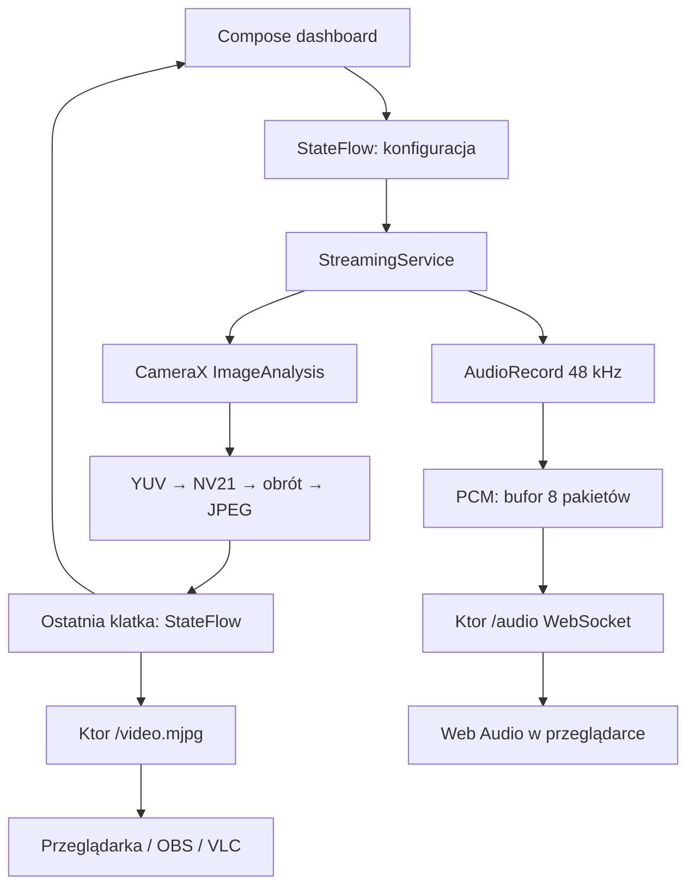

# EyeDroid

Natywna kamera sieciowa Android → komputer. Kotlin, Jetpack Compose Material 3, CameraX, Ktor CIO. Ciemny panel studia z limonkowym akcentem, podglądem rzeczywistej transmisji, wskaźnikami i sterowaniem kamerą. Bez konta, chmury i reklam.

**Status: implementacja MVP do walidacji na urządzeniach, nie zweryfikowane wydanie produkcyjne.** Pełny opis ograniczeń i sprawdzania: [VALIDATION.md](docs/VALIDATION.md). Projekt napisany od podstaw; nie zawiera kodu, zasobów ani protokołu DroidCamX.

## 1. Gradle i zależności

Wersje przypięte; nie używaj `+` ani EAP. Dokumentacja wydań sprawdzona 10.10.2026; cały zestaw wymaga udanego CI przed wydaniem.

| Element | Konfiguracja |
|---|---|
| JDK / Gradle wrapper | 17 / 9.3.1 + SHA-256 dystrybucji |
| Android Gradle Plugin | 9.1.1, wbudowana obsługa Kotlin |
| Kotlin / Compose compiler | 2.4.21 |
| Compose BOM | 2026.09.00 |
| Material 3 | wersja z BOM |
| CameraX | 1.6.2 |
| Activity / Lifecycle | 1.13.0 / 2.11.0 |
| Ktor CIO + WebSockets | 3.6.0 |
| Coroutines | 1.10.2 |
| Android | minSdk 26; compileSdk i targetSdk 37 |

Główna konfiguracja: [build.gradle.kts](build.gradle.kts). AGP 9 używa wbudowanego Kotlin: **nie dodawaj** `org.jetbrains.kotlin.android`. Wyższa wersja KGP jest jawnie zadeklarowana w `buildscript`. Compose compiler ma tę samą wersję co Kotlin.

```kotlin
// app/build.gradle.kts — kluczowe zależności
implementation(platform("androidx.compose:compose-bom:2026.09.00"))
implementation("androidx.compose.material3:material3")
implementation("androidx.activity:activity-compose:1.13.0")
implementation("androidx.lifecycle:lifecycle-service:2.11.0")
implementation("androidx.lifecycle:lifecycle-runtime-compose:2.11.0")
implementation("androidx.camera:camera-camera2:1.6.2")
implementation("androidx.camera:camera-lifecycle:1.6.2")
implementation("org.jetbrains.kotlinx:kotlinx-coroutines-android:1.10.2")
implementation("io.ktor:ktor-server-cio:3.6.0")
implementation("io.ktor:ktor-server-websockets:3.6.0")
```

Pełny, wykonywalny plik zawierający pluginy, SDK, Java 17 i zależności testowe: [app/build.gradle.kts](app/build.gradle.kts).

## 2. AndroidManifest i uprawnienia

```xml
<uses-permission android:name="android.permission.CAMERA" />
<uses-permission android:name="android.permission.RECORD_AUDIO" />
<uses-permission android:name="android.permission.INTERNET" />
<uses-permission android:name="android.permission.ACCESS_NETWORK_STATE" />
<uses-permission android:name="android.permission.ACCESS_WIFI_STATE" />
<uses-permission android:name="android.permission.ACCESS_LOCAL_NETWORK" />
<uses-permission android:name="android.permission.FOREGROUND_SERVICE" />
<uses-permission android:name="android.permission.FOREGROUND_SERVICE_CAMERA" />
<uses-permission android:name="android.permission.FOREGROUND_SERVICE_MICROPHONE" />
<uses-permission android:name="android.permission.POST_NOTIFICATIONS" />
<uses-permission android:name="android.permission.WAKE_LOCK" />

<service android:name=".StreamingService"
    android:exported="false"
    android:foregroundServiceType="camera|microphone"
    android:stopWithTask="false" />
```

Kompletny manifest: [AndroidManifest.xml](app/src/main/AndroidManifest.xml).

- Kamera, opcjonalny mikrofon i (od API 37) dostęp do LAN są sprawdzane w runtime przed startem. Powiadomienia są proszone od API 33, ale odmowa nie blokuje legalnej usługi foreground.
- Dla targetSdk 37 zadeklarowano nowe `ACCESS_LOCAL_NETWORK`; na starszych urządzeniach nie jest proszone. Przy świadomym obniżeniu target do 36 usuń tę deklarację i gałąź runtime zgodnie z dokumentacją Androida.
- Brak lokalizacji, dostępu do plików, autostartu po boot, pracy po force-stop i niejawnego startu kamery w tle.
- Nie potrzeba globalnego `usesCleartextTraffic=true`: aplikacja jest serwerem i lokalny podgląd dekoduje bajty JPEG bez klienta HTTP. Komputer łączy się z telefonem po HTTP.

## 3. Uruchomienie krok po kroku

1. Otwórz katalog projektu w Android Studio obsługującym AGP 9.1.1. Ustaw JDK 17.
2. W SDK Manager zainstaluj Android SDK Platform 37 i Build Tools 36.0.0. Android Studio zapisze lokalne `sdk.dir` w ignorowanym `local.properties`.
3. Poczekaj na Gradle Sync. Na terminalu uruchom:

   ```sh
   ./gradlew testDebugUnitTest lintDebug assembleDebug
   ./gradlew installDebug
   ```

   Windows: `gradlew.bat`. APK: `app/build/outputs/apk/debug/app-debug.apk`.
4. Telefon i komputer podłącz do tej samej zaufanej sieci Wi-Fi; wyłącz izolację klientów/AP isolation w routerze, jeśli jest włączona. Hotspot, IPv6-only i VPN nie są obsługiwane w tym MVP.
5. W aplikacji ustaw mikrofon i port, wybierz **Rozpocznij transmisję**, udziel uprawnień. Zobaczysz rzeczywisty adres Wi-Fi telefonu i nowy klucz sesji.
6. **Kopiuj link** tworzy URL `http://IP:PORT/#TOKEN`. Na komputerze otwórz ten link albo wpisz adres i przepisz klucz widoczny po rozwinięciu w aplikacji. Naciśnij **Połącz kamerę**.
7. Naciśnij **Włącz odsłuch mikrofonu** w przeglądarce — interakcja użytkownika jest potrzebna do uruchomienia AudioContext. Użyj słuchawek.
8. Możesz zminimalizować aplikację i zablokować ekran. Zatrzymuj transmisję przyciskiem w aplikacji albo w powiadomieniu. Testuj zachowanie oszczędzania energii na konkretnym telefonie; foreground service nie gwarantuje nieprzerwanej pracy na każdym OEM.

Zmiana Wi-Fi/IP kończy sesję zamiast pozostawiać błędny adres. Uruchom ją ponownie, aby dostać nowy URL i token. Maksymalny czas jednej sesji wynosi sześć godzin; limit odpowiada ograniczonemu czasowo wake lockowi.

## 4. Architektura



**Własność zasobów:** kamera jest związana z `LifecycleService`, nigdy z Activity. Activity wyświetla dekodowane klatki tej samej transmisji i nie posiada kamery. Obrót/rekompozycja UI nie przerywa sesji. Podgląd telefonu jest próbkowany do ~6 FPS, aby ograniczyć koszt dekodowania; nie ogranicza FPS serwera.

**Backpressure:** CameraX `KEEP_ONLY_LATEST`; jeden executor konwersji; jeden JPEG dla wszystkich klientów; każdy odbiorca dostaje ostatnią klatkę przez StateFlow. `ImageProxy.close()` jest zawsze w `finally`. Wolny odbiorca nie blokuje przechwytywania. Audio ma ograniczony bufor i odrzuca stare pakiety. Cztery jednoczesne połączenia mediów (przeglądarka z obrazem i audio zajmuje dwa). Timeout wysyłki i zamknięcie serwera zwalniają subskrypcje; test slow-client jest obowiązkowy przed wydaniem.

**Sterowanie:** rozdzielczość i wybór obiektywu powodują rebind. FPS jest limitem kodowania/wysyłania, nie obietnicą FPS sensora. CameraX może dobrać rozdzielczość zastępczą; panel pokazuje rzeczywisty rozmiar. Błędna konfiguracja przywraca poprzednią. Orientacja strumienia jest stała względem naturalnej orientacji urządzenia (`ROTATION_0`); automatyczny obrót i lustrzany podgląd nie są jeszcze funkcjami MVP.

**Audio:** signed PCM16 little-endian, 48 000 Hz, mono, zwykle 960 próbek / 20 ms. WebSocket wysyła najpierw metadane JSON, potem pakiety binarne. Odbiornik korzysta z AudioBufferSourceNode i ogranicza kolejkę do 250 ms; dzięki temu działa po zwykłym HTTP LAN bez wymagania AudioWorklet w secure context. To rozwiązanie podstawowe, podatne na jitter głównego wątku przeglądarki. Nie ma synchronizacji A/V ani gwarancji opóźnienia.

## 5. Najważniejsze pliki Kotlin

| Plik | Odpowiedzialność |
|---|---|
| [MainActivity.kt](app/src/main/kotlin/pl/eyedroid/MainActivity.kt) | Compose: adaptacyjny panel, podgląd, pozwolenia, kontrolki, kopiowanie URL |
| [StreamingService.kt](app/src/main/kotlin/pl/eyedroid/StreamingService.kt) | lifecycle, foreground notification, start/stop, wake lock i sprzątanie |
| [HttpServer.kt](app/src/main/kotlin/pl/eyedroid/HttpServer.kt) | Ktor CIO, MJPEG, WS audio, autoryzacja, limity i HTTP API |
| [CameraEngine.kt](app/src/main/kotlin/pl/eyedroid/CameraEngine.kt) | CameraX, kompresja, throttling, metryki i rebind |
| [Yuv420.kt](app/src/main/kotlin/pl/eyedroid/Yuv420.kt) | stride-aware konwersja i obrót NV21, bez zależności Android |
| [AudioEngine.kt](app/src/main/kotlin/pl/eyedroid/AudioEngine.kt) | pojedynczy AudioRecord i bezpieczne zwalnianie |
| [LocalNetwork.kt](app/src/main/kotlin/pl/eyedroid/LocalNetwork.kt) | adres IPv4 konkretnej sieci Wi-Fi i reakcja na zmiany |
| [StreamState.kt](app/src/main/kotlin/pl/eyedroid/StreamState.kt) | niezmienne modele, walidacja i magistrala mediów |
| [EyeDroidApp.kt](app/src/main/kotlin/pl/eyedroid/EyeDroidApp.kt) | lokalne preferencje bez utrwalania klucza sesji |
| [receiver.html](app/src/main/assets/receiver.html) | rzeczywisty odbiornik obrazu/audio i pilot kamery |

## 6. HTTP API i integracje

| Endpoint | Dostęp / zachowanie |
|---|---|
| `GET /` | strona odbiornika, bez danych kamery |
| `GET /health` | publiczna identyfikacja procesu, bez szczegółów |
| `GET /video.mjpg?token=…` | MJPEG, `multipart/x-mixed-replace; boundary=eyedroid` |
| `WS /audio?token=…` | PCM16 mono; wymaga włączonego mikrofonu |
| `GET /api/status` | Bearer token; FPS, rozmiar, liczba połączeń, błąd |
| `POST /api/config?fps=15&quality=70` | tylko Bearer token; 202 = przyjęto, nie potwierdzono zastosowania |

Dozwolone pola `/api/config`: `width`, `height`, `fps`, `quality`, `front`, `torch`. Rozmiary: 640×480, 1280×720, 1920×1080. FPS: 15/24/30. Jakość: 40–90. Kamera przednia wymaga `torch=false`. Mikrofon i port zmienia się lokalnie przed startem.

```sh
curl -H "Authorization: Bearer TOKEN" http://IP:4747/api/status
curl -X POST -H "Authorization: Bearer TOKEN" \
  'http://IP:4747/api/config?front=true&torch=false&fps=15'
```

- **VLC:** Media → Open Network Stream → URL z przycisku **Link VLC**. Ten endpoint daje tylko obraz. VLC nie odtworzy naszego niestandardowego WebSocket PCM bez adaptera.
- **OBS:** dodaj Browser Source z URL odbiornika zawierającym fragment `#TOKEN`, otwórz Interact i kliknij połączenie/odsłuch. Włącz kontrolę audio przez OBS, jeśli dostępna. Przy samym obrazie można próbować Media Source z MJPEG, z wyłączonym „Local File”; zgodność trzeba sprawdzić dla konkretnej wersji OBS.
- **Przeglądarka:** Chrome/Edge/Firefox jako cele testowe. Odtwarzanie audio wymaga kliknięcia; ponowne połączenie jest ręczne.
- **Teams/Zoom jako kamera systemowa:** nie jest to sterownik kamery wirtualnej. Można użyć OBS Virtual Camera dla obrazu; dźwięk wymaga niezależnego routingu na PC. Natywny klient desktop to osobny etap produktu.

## 7. Bezpieczeństwo i wydajność

Serwer wiąże gniazdo z konkretnym adresem Wi-Fi, nie `0.0.0.0`. Losowy token 192-bit zmienia się przy każdej sesji. Polecenia wymagają Bearer; media dopuszczają token w URL dla zgodności z ``, WebSocket i VLC. Origin jest sprawdzany, CORS nie jest otwierany. Strona ma `no-store`, `no-referrer` i `X-Frame-Options: DENY`. Token nie jest zapisany w preferencjach ani logowany przez aplikację.

**HTTP i WS nie szyfrują.** Token nie chroni przed podsłuchem w LAN. Link mediów może trafić do historii VLC/schowka; nie udostępniaj go publicznie. Nie przekierowuj portu routera do internetu. Przed produkcją: pairing z zatwierdzeniem na telefonie, odwoływanie klientów, TLS lub WebRTC DTLS-SRTP i audyt transportu.

MJPEG jest ścieżką kompatybilności, nie najlepszym kodekiem. Przykładowo klatka 100 kB × 24 FPS to około 19,2 Mb/s na klienta, bez narzutów. 1080p może grzać telefon. Brak klienta nie zatrzymuje kodowania, ponieważ podgląd telefonu korzysta z tego samego strumienia. Kolejny krok: sprzętowe H.264 + WebRTC/Opus, wspólny zegar mediów, adaptacja bitrate, pomiary termiczne i opóźnienia p50/p95.

## 8. Produkt i monetyzacja

Zobacz [PRODUCT.md](docs/PRODUCT.md): propozycja Free/Pro, hipotezy cenowe, roadmapa i warunki wydania. W kodzie MVP nie ma płatności, blokad Pro ani reklam. Funkcje pokazane w UI są dostępne bez opłat.

## Źródła techniczne

- [CameraX release notes](https://developer.android.com/jetpack/androidx/releases/camera)
- [Compose BOM](https://developer.android.com/develop/ui/compose/bom)
- [Kotlin releases](https://kotlinlang.org/docs/releases.html)
- [AGP 9.1 compatibility](https://developer.android.com/build/releases/agp-9-1-0-release-notes)
- [Built-in Kotlin](https://developer.android.com/build/migrate-to-built-in-kotlin)
- [Ktor releases](https://ktor.io/docs/releases.html)
- [Foreground service types and restrictions](https://developer.android.com/develop/background-work/services/fgs/service-types)
- [Local network permission](https://developer.android.com/privacy-and-security/local-network-permission)

Kod w repozytorium nie otrzymał automatycznie licencji open source. Właściciel powinien wybrać model licencji przed dystrybucją. Nazwa i branding EyeDroid wymagają osobnej weryfikacji przed publikacją komercyjną.
